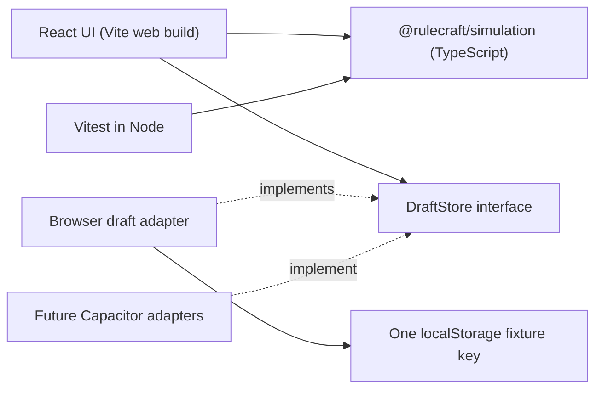

# Task 00 architecture audit and portability spike

## Recommendation

Use a platform-independent TypeScript simulation package, React and Vite for the mobile-first web shell, and Vitest for headless tests. Evaluate Capacitor as the packaged-app route after testing on devices. Keep presentation and platform services outside the simulation, including storage, app lifecycle and sharing. The Task 00 fixture uses Node.js and Chromium. It tests matching fixture bytes and a browser reload, with no simulated turns or claims about deterministic replay.

| Decision | Trade-off and validation |
|---|---|
| TypeScript core | One implementation can run headless in Node and in web/native WebViews. Versioned integer arithmetic, stable ordering and explicit keyed draws still need replay tests. Benchmark a representative turn on physical phones before introducing Web Workers or additional runtime complexity. |
| React/Vite shell | Native HTML controls, responsive CSS, accessible text and a static web build suit a decree editor and phone-first navigation. Keep the village scene behind the presentation layer. Start with a small DOM/CSS scene, and consider Canvas if animation profiling calls for it. HTML investigation controls can remain accessible alongside a Canvas scene. |
| Local-first continuity | Serve a static bundle over HTTPS and plan a versioned service-worker cache for offline web relaunch. Store committed turns as transactional snapshots with a prior checkpoint. Keep editable drafts separate. A packaged app can bundle assets and use a native storage adapter. Test offline upgrades, interrupted writes and resume before relying on either approach. |
| Capacitor candidate | Shares the web build and can expose native lifecycle, storage and sharing through adapters. Measure WebView interaction fidelity, package size, launch latency, memory and rendering on Android and iOS. Native build tooling, signing and store review remain separate work. |
| Godot alternative | Godot offers integrated 2D scenes, animation, profiling and Android/iOS export. Its web export adds an engine payload and browser constraints, and a GDScript core would change the standalone TypeScript strategy and its Node test workflow. Revisit if measured 2D scene needs outweigh the advantages of web-native forms and independent headless tests. |

The npm workspace gives the shell and Vitest a single package entry point. A separate compiler check for the simulation restricts ambient APIs to ECMAScript. This makes small headless changes easy to run in Codex and keeps app and build tools out of the simulation package.

`DraftStore` reads and replaces one opaque draft payload asynchronously so a future native implementation can perform device I/O. The Task 00 adapter uses one localStorage entry for the disposable fixture. The proposed production save interface will commit a complete versioned snapshot and retain a previous checkpoint, with separate draft storage. Proposed adapter seams also cover local share/export, app foreground/background, safe areas and bundled versus cached assets. Interruption-safe turns, schema migration and offline relaunch remain later tests.

## Specification conflicts and decisions

The references below use section numbers from the [technical specification](02_Technical_Systems.md), [vertical slice](03_Vertical_Slice.md), and [master game design](01_Master_GDD.md). The proposals need owner review before their affected milestones.

| Issue | Where the contract breaks or leaves a decision open | Proposal for review |
|---|---|---|
| Stale decree beliefs | Technical §§4–5 preserve obsolete citizen knowledge after repeal and amendment. §14 derives perceived law only from current rules, which removes superseded beliefs immediately. | Read actual law from current authority and perceived law from the citizen's known versions. Preserve obsolete beliefs until notice arrives. Official enforcement always uses current law. Approve before Task 02. |
| Impossible action evidence | Technical §§6–8 and §14 filter out infeasible actions before choice. BUILD-07 and AGT-03 require a reasoned blocked attempt when a farmer tries to harvest an empty field. | Record unavailable intended actions and failed assigned attempts explicitly. Keep a rejected candidate, a failed attempt and a deliberate violation distinct. Approve the event meanings before Task 01. |
| Enactment and save ordering | The master design §4 gives changes immediate legal effect for the next turn. Technical §§6 and 14 commit pending operations at the start of advancement, while the slice requires enacted changes to survive interruption between turns. A single queue cannot serve both the draft and enacted state without a defined commit boundary. | Treat confirmation as a durable between-turn enactment effective at the next slot. Keep unconfirmed drafts separate. Advance from the committed snapshot and atomically commit a completed turn. Use stable command IDs for repeat submissions. Confirm before the save contract and Task 02. |
| Permission, precedence and enforcement | Technical §5 gives a starting order for opposing rules, but leaves gaps for `MUST` without an export licence, `MAY` versus `MUST`, narrower scopes, numeric priority availability and actions based on stale knowledge. BUILD-09 also allows documented passive detection, while the guard model restricts investigations to patrol capacity. | Approve an explicit modality and licence truth table, including ties and enforceability, and use zero passive enforcement in the first slice. Treat distinct duties as competing for slots. Confirm before Task 02, with behavioural enforcement scheduled for Task 03. |
| Ownership, scarcity and contention | The slice §2 describes 45 starting units in “market/granary” but §3 assigns food to producer and market accounts without specifying granary access. Export payer/payee and inventory ownership, partial deliveries with fees, and who gets scarce food or work capacity need explicit rules. | For the initial headless fixture, propose all 45 accessible opening units in the market account, producer ownership until a funded delivery, market-funded fees, treasury-funded wages and matched buyer payments for exports when added. Resolve competing claims in deterministic order with a documented tie-break. Confirm account legs and settlement order before Task 01. |
| Action registry and slot timing | The slice §§2–4 gives six decree-targetable actions and dusk operations, with unsafe routes optional. Technical §§3 and 6 require stable registry IDs, eligibility, conditions and phase snapshots. The master design §5 includes bandit risk as an example, outside the first slice's action context. | Approve the slice catalogue and capability matrix, two daytime slots plus dusk, and a declared snapshot and ordering for each phase. Omit unrepresented route/bandit predicates from the baseline registry. Use explicit units for every exposed threshold. |
| Mode profile boundary | Technical §11 and slice §§4 and 7 propose exposure and unlock differences, but the starting token inventories and treatment of hidden features in loaded saves are unspecified. | Approve initial Junior/Full profiles and fixed mode per save. Share all action and predicate semantics. Keep the Task 01 fixture headless and approve profile-specific authoring and load rules before Task 02 and Task 06. |
| Reproducible RNG and save compatibility | Technical §§2, 6 and 13 specify keyed randomness and versioned saves but leave the algorithm, key encoding, fixed-point scale, overflow policy, stable sort and canonical hash unspecified. | Approve a written compatibility contract before Task 01. Use bounded integer quantities, explicit UTF-8 key bytes, versioned keyed draws, stable ID ordering and a canonical state/event encoding. Pin golden vectors, define overflow failures, and reject unsupported save versions explicitly. Choose algorithm and numeric bounds in the first reviewed Task 01 increment before implementing behaviour. |
| Milestone order | The slice §12 and Task 01 put the rule-free kernel before the compiler. The master design's closing next-task paragraph also suggests one law compiler path in the initial headless prototype. | Follow the explicit Task 01 scope and defer executable law handling to Task 02. Keep only the interfaces required for the rule-free fixture. |

## Balance and later calibration

The 40-person split, 12 days, initial stocks, production rates, prices, allowances, awareness coefficients and latency targets are candidate fixture data. With no new crop stock after setup, the proposed 45 market food and 450 harvestable crop imply an optimistic total of 495 units before delivery losses, exports or other drains. At 40 citizens for 12 days, the proposed 90% food target and 40-unit ending reserve require 472 units, leaving 23 units of headroom even with full conversion and access. Validate capacity, funding and access in the baseline, then tune on seeded samples. Defer scoring weights, peer influence, retention budgets, device performance and Junior reading difficulty to the relevant gates.

## Verification and release path

Task 00 ran on Linux with Node.js 24.22.3, npm 11.19.1 and Chromium 156.

| Check | Result |
|---|---|
| `npm ci` with a writable cache | Installed successfully from `package-lock.json` |
| `npm test` | Eight passed, covering the shared fixture bytes and seed boundaries, including invalid inputs |
| `npm run build` | Passed both compiler checks and the production bundle |
| `npm run dev` and `npm run preview` | Chromium touch emulation passed at 320 × 640 in development and 390 × 844 in production preview. Both showed the expected bytes, a touch target of at least 44 CSS pixels and no horizontal overflow. Touch saved the fixture, reload restored it, and saving replaced a stale payload. |

- Run `npm ci`, `npm test` and `npm run build` in a Linux pull-request job with the Node version from `.nvmrc`. Keep the lockfile in the repo. Publish test output as needed and add browser automation when the team adopts a browser test runner.
- After reviewing the packaging route, select and pin a matching Capacitor release for core, CLI and platforms, with its documented JDK, Android SDK and Xcode versions. Add `@capacitor/core` and `@capacitor/cli`, initialise with owner-approved reverse-DNS app ID and `webDir: 'dist'` (`npx cap init Rulecraft <app-id> --web-dir dist`), and use `npm run build` before syncing.
- On an Android toolchain host, install the matched `@capacitor/android`, run `npx cap add android`, then `npx cap sync android` and `npx cap run android` with Android Studio/SDK, supported JDK, and an emulator or USB-debug enabled phone. Run `./gradlew assembleDebug` from `android/` to verify the Android debug build independently.
- On macOS with supported Xcode and command-line tools, install the matched `@capacitor/ios`, run `npx cap add ios`, then `npx cap sync ios` and `npx cap run ios` using an iOS simulator. For a physical phone, configure a development signing team and provisioning in Xcode. Use `npx cap open ios` to check target settings and build from Xcode.
- In mobile Safari and Chrome on physical phones, record device, OS, orientation and browser, and repeat the fixture tap and reload offline after asset caching exists. In the native shell, verify bundled launch offline, safe areas and text scaling, touch, background/force-close and reopen. Later run the real cross-runtime replay golden fixture and interruption and sharing checks. See the [Capacitor environment setup](https://capacitorjs.com/docs/getting-started/environment-setup) and [existing web app guide](https://capacitorjs.com/docs/getting-started).

Physical Android/iOS browser tests, native builds, offline relaunch and gameplay acceptance checks BUILD-21, BUILD-22 and BUILD-24 remain pending. The cloud host is Linux and lacks the Android SDK/ADB and Xcode tools.

## Proposed next ticket after approval

Task 01 is the 12-day rule-free village kernel. Use three independently testable changes.

1. Pin versioned fixture schema, canonical encoding, keyed RNG and stable actor order. Verify golden draws, reordered input, invalid seeds and unknown save versions.
2. Add action slots and auditable producer-to-market-to-consumer transfers with capacity and funding checks. Verify zero-stock attempts, insufficient funds, no delivery, non-negative balances and explicit source/sink accounting for food, timber and coin.
3. Add twelve-day progression, event output, snapshots and replay. Compare state and event hashes after reload, test the commit boundary on interruption, and report seeded baseline outcomes and balance assumptions.
